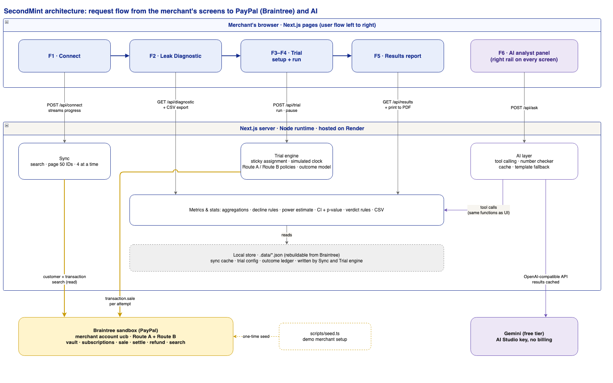

# SecondMint: Technical Spec

v0.2 · companion to [Product.md](Product.md) (v0.5) · submission due Nov 12, 2026, 12:00pm

## 1. Hackathon requirements → how we meet them
| Requirement | How SecondMint meets it |
|---|---|
| Meaningful PayPal integration | Braintree (a PayPal service) sandbox runs the whole data path: vault, customers, subscriptions, sales, settlement, refunds, search, and processor response codes. The PayPal REST sandbox is connected (OAuth verified) and reserved for the v2 wallet arm. |
| Meaningful AI | (1) A grounded leak summary on the Diagnostic, with every number checked. (2) An AI analyst that answers through tool calls over the ledger. (3) The executive summary of the results report, checked against the rule-based verdict. |
| Working prototype | A hosted demo on Render, plus a README that lets judges run it locally against their own Braintree sandbox. |
| Documentation | README (setup, architecture, real vs. simulated, tools used), Product.md, and TechSpec.md. |
| Submission | MIT `LICENSE` at the repo root, a public GitHub repo, a demo video under 3 minutes on YouTube, and a "Tools used" section in the README. |

## 2. Architecture


*Editable source: [docs/diagrams/architecture.drawio](docs/diagrams/architecture.drawio).*

How to read it:
- **Top row:** the merchant's flow, left to right: Connect → Leak Diagnostic → Trial → Results. The AI analyst sits beside every screen.
- **Middle:** each screen calls one API route. The Diagnostic, Results, and AI analyst all read through the same **Metrics & stats** module, so the AI can't disagree with the dashboard.
- **Bottom:** only Sync, the Trial engine, and the seed script talk to Braintree. Only the AI layer talks to Gemini.
- **Data:** the Braintree sandbox is the source of truth. `.data/` is a rebuildable local cache; Render's disk resets on restart, so any page that finds no cache offers "Connect" again.
- **Deployment:** one Next.js app, with no separate backend or database server.

## 3. Stack
| Layer | Choice | Why |
|---|---|---|
| App | Next.js 16, React 19, TypeScript | One codebase for UI and API |
| Styling | Tailwind CSS 4, with tokens from Product.md §7 | Holds the visual system in one place |
| Payments | `braintree` Node SDK, sandbox environment | PayPal integration with the richest decline data |
| Tables | AG Grid Community | Sort, filter, and group; also a sponsor prize category |
| Charts | Recharts | Bar charts and timelines |
| Stats | Our own code (~60 lines) | Two-proportion z-test, 95% CI, power; no dependency |
| AI | Gemini (`gemini-2.5-flash`) through its OpenAI-compatible endpoint. Configured by `AI_BASE_URL`, `AI_API_KEY`, `AI_MODEL` in `.env` | The provider can be swapped without code changes |
| PDF export | Browser print with a print stylesheet | No PDF library needed |
| Hosting | Render web service with a `render.yaml` blueprint | Hosted judge URL; also a sponsor prize category |
| Diagrams | Vendored `draw-diagram` skill, rendered with Playwright | Editable `.drawio` sources plus PNGs |
| Tests | Node's built-in test runner (via `tsx`) | No extra test framework |

## 4. Data model
- **SyncedTransaction** (cache): id, orderId, status, amount, code, text, merchantAccountId, customerId, card (brand, debit, last4), refunded, createdAt, and custom fields `sm_invoice_id`, `sm_subscription_id`, `sm_billing_date`, `sm_attempt_at`, `sm_attempt_no`, `sm_invoice_amount` (plus `sm_route` for trial attempts).
- **Invoice** (derived, not stored): grouped by `sm_invoice_id`. Fields: amount, billing date, first decline code, decline type, attempts[], status, recovered at, days to recover, refunded, net $.
- **DeclineRule** (static table): code → plain name, soft/hard, Visa retry category, attempt cap (e.g. Visa: 15 per 30 days).
- **Trial**: id, seed, length, recovery window, split, start date, readiness checks, status (draft / running / paused / complete / stopped).
- **Assignment**: customerId → route. Computed as `sha256(customerId + trialSeed)`, taken mod 100, compared with the split. Never stored, so it's always reproducible.
- **LedgerEntry**: trialId, invoiceId, route, attempt #, simulated time, Braintree transaction id, code, result, fee.

## 5. Feature design

### F1. Connect (built; keys verified, seed not yet run)
- **Seed (`npm run seed`):** builds a deterministic plan from a seeded RNG, then executes it.
- **Execution:**
  - **8 calls in parallel:** each sandbox call takes roughly 0.3–0.6 seconds. About 6,000 calls one at a time would take ~45 minutes; 8 at a time brings that to ~6–10 minutes. Braintree publishes no fixed rate limit, so we stay at a moderate level that's unlikely to trigger `429 Too Many Requests`. Any 429 or timeout is retried with exponential backoff (0.5s, 1s, 2s…).
  - **Resumable:** a progress file means a crash or rate limit costs nothing; rerunning picks up where it stopped.
- **Retry order:** attempts run in chronological rounds (every first attempt, then every first retry…), so repeat charges on one card are minutes apart. This avoids Braintree's duplicate-transaction check.
- **Outcome encoding:** a decline uses the sandbox test amount (`2000–2999.00` returns that code; `3000.00` returns 3000). A success sends the real plan price, then calls `testing.settle`.
- **Custom-field check:** one preflight sale confirms the custom fields exist before the bulk run.
- **Sync (`POST /api/connect`):** uses customer search and transaction search (`orderId` starting with `sm2-inv-`; the earlier `sm-` history is left in the sandbox but never synced). It fetches 50 IDs per page, 4 pages at a time, and streams NDJSON progress to the UI.

### F2. Leak Diagnostic
- **Endpoints:**
  - `GET /api/diagnostic?filters…` returns every dashboard section in one payload, so all sections stay consistent with the filters.
  - `GET /api/diagnostic/export.csv?filters…` streams the CSV in the column order fixed in Product.md: UTF-8 with a BOM for Excel, ISO dates, plain numbers.
- **Computation:** in memory over the cache (about 4,000 transactions takes milliseconds), well inside the 3-second target.
- **Waste:** any retry of a hard decline, and any attempt beyond its decline rule's cap. Excess fee = attempts over the cap × $0.10 (Braintree's documented domestic Visa fee).
- **Trial-length estimate:** sample size per arm for a two-proportion test (α = 0.05, power = 0.8), using the current recovery rate as the baseline and the recent rate of eligible failures.
- **AI summary:**
  - The server sends the model a JSON "facts" object, and the model writes at most 150 words.
  - A checker pulls every number out of the text and confirms it appears in the facts. If one doesn't, it retries once, then falls back to a template summary.
  - The summary is cached for each sync.

### F3. Trial setup and readiness
- **Storage:** `POST /api/trial` saves the draft trial. Assignment and balance are computed on read.
- **Balance check:** compares the two routes on count, $, decline mix, and plan mix. A difference over 5 percentage points shows a warning.
- **Start rule:** "Start" is also enforced on the server; the API refuses to start a trial while any readiness item is unchecked.
- **Population:** all synced customers are assigned up front. Balance is checked on each route's last 90 days of soft-decline history. If any difference exceeds 5 pp, "Reshuffle groups" draws a new seed.

#### Trial handoff (F3 → F4)
F3 ends by saving `.data/trial.json` with `status: "running"`. F4 reads it and must not change any setting.
```ts
type Trial = {
  id: string; seed: string; status: "draft" | "running";
  lengthDays: number;          // enrollment period: failures in these days join the trial
  recoveryWindowDays: number;  // follow each failure this long after its first failure
  splitB: number;              // % of customers on Route B
  earlyStop: { stopIfBWorse: boolean; maxComplaints: number };   // F4 enforces
  readiness: { consent: boolean; dataScope: boolean; earlyStop: boolean; oneRoutePerInvoice: boolean };
  createdAt: string; startedAt: string | null;
};
```
- **Route of a customer:** `assignRoute(customerId, trial.seed, trial.splitB)` from `src/lib/trial.ts`. Don't reimplement it.
- **Which failures join the trial:** soft declines only (`ruleFor(code).type === "soft"` from `src/lib/declines.ts`).
- **API:**
  - `GET /api/trial` returns the trial and its preview.
  - `POST /api/trial` updates a draft (409 once running; `{ "reshuffle": true }` draws a new seed).
  - `POST /api/trial/start` returns 400 with the `missing` items if readiness is incomplete.
  - `DELETE /api/trial` discards the trial.

### F4. Run trial
- **Simulated clock:** the engine advances day by day. Each day it creates that day's renewal failures for trial customers (same generator, new seed), then runs each route's policy for the invoices due that day.
- **Route A:** the existing schedule from `config/seed.config.ts`.
- **Route B:** no hard-decline retries, and code-aware timing:
  - 2001 (insufficient funds): retry on the next 1st or 15th (payday).
  - 3000 (network unavailable): retry the next day.
  - Other soft codes: retry at days 2, 5, and 9.
  - Attempts are capped by the decline rule.
- **Routing:**
  - The sandbox has one merchant account (`ucb`), so every attempt is tagged with its route in an `sm_route` custom field (the Product.md §11 fallback).
  - If you add a second sandbox merchant account, set `BRAINTREE_ROUTE_B_ACCOUNT_ID` and Route B uses it, with no code change.
- **Outcome model:** driven by the trial's editable assumptions (`src/lib/assumptions.ts`; defaults and sources in Product.md F3).
  - Each route gets per-retry odds `1 − (1 − target)^(1/n)`. Here `n` is the number of retries that route schedules for that invoice, and the target is `currentRecovery` for Route A or `currentRecovery + smartUplift` for Route B. So each route recovers its stated rate whatever its schedule.
  - New failures use `renewalFailureRate` and `softShare`. The seeded history uses the same market values (85% soft, 0.085 per retry ≈ 30% recovery).
  - **Rule:** assumptions come from market benchmarks and are never tuned to make a trial conclusive. The report says "simulated outcomes" and shows the volume needed for a verdict.
- **Duplicate guard:** a sale is skipped if its invoice is already collected; the ledger enforces one success per invoice.
- **Fast-forward:** NDJSON progress streams to the UI. 21 days is about 400–700 sandbox calls; at 8 in parallel that's under 60 seconds. Pause stops the day loop.

### F5. Results report
- **Statistics:**
  - Uplift = p_B − p_A.
  - The 95% CI uses Newcombe's hybrid score interval, which is reliable for small samples.
  - The p-value comes from a two-proportion z-test.
- **Verdict:** a pure function implementing Product.md's three rules, unit-tested at each boundary.
- **Exports:**
  - Print-to-PDF uses a dedicated `@media print` layout.
  - The results CSV reuses the F2 exporter with the ledger joined in.

### F6. AI analyst
- **Tools:**
  - `get_metrics(scope, filters)`
  - `breakdown(dimension, filters)`
  - `compare_routes(metric, filters)`
  - `list_invoices(filters, limit)`

  All of them call the same functions the dashboard uses.
- **System prompt rules:**
  - Answer only from tool results, and cite each metric name.
  - Say "the data can't answer that" when it can't.
  - Never state real-world PayPal performance.
- **Citations:** each answer includes a link to the matching filtered view.
- **Report summary:** the verdict is passed in as an input the model must not contradict, and a post-check compares the verdict words.
- **Rate limits:**
  - One request at a time, and responses are cached by question + data version.
  - On a limit error, the panel says so and shows suggested questions. The rest of the app keeps working.
- **Guardrail tests:** a script sends ≥ 3 adversarial prompts and asserts that each response refuses or carries the disclaimer.

## 6. Quality and verification (per feature, before the next one starts)
- **Unit tests:** generator, decline classification, aggregations, statistics, verdict rules, CSV schema, and the AI number checker.
- **Sandbox smoke test:** a script runs each feature's main path against the real sandbox. For F1 that's seed → sync → counts match the plan.
- **Browser check:** each screen in all four states, at 1280px and 768px, keyboard-only navigation, and an axe-core accessibility pass.
- **Gate:** a feature is done only when its Product.md acceptance criteria are checked off and you have reviewed it.

## 7. Deployment
- **Render blueprint:** `render.yaml` defines one web service (`npm ci && npm run build`, then `npm start`). Secrets are set in the Render dashboard, never committed.
- **Cold starts:** the service sleeps when idle, so the first request takes about 30–50 seconds. The README warns judges, and we wake it before recording the demo.
- **Seeding:** the seed runs once, from a laptop, against the same sandbox the hosted app uses.

## 8. Risks
| Risk | Mitigation |
|---|---|
| Gemini request limits are low | One cached call per sync for the summary, and cached analyst answers. A template fallback keeps the app fully usable without AI |
| A 3,000-customer trial may lack power to reach a verdict | The power estimate is shown up front and the report says how much volume is needed. Assumptions are never tuned to force a verdict |
| Route B's uplift comes from our outcome model | Parameters are in one file, labeled in the UI, and the report says "simulated." The pitch is the measurement method, not the number |
| Render's disk resets | Everything rebuilds from the Braintree sandbox through Connect |
| One merchant account in the sandbox | Route tag in a custom field. A second account can be added later with no code change |

## Sources
[Braintree testing](https://developer.paypal.com/braintree/docs/reference/general/testing/node) · [Braintree declines](https://developer.paypal.com/braintree/articles/control-panel/transactions/declines) · [Render free tier](https://render.com/articles/platforms-with-a-real-free-tier-for-developers-in-2026) · [Gemini free tier (Oct 2026)](https://klymentiev.com/blog/gemini-api-free-tier)
