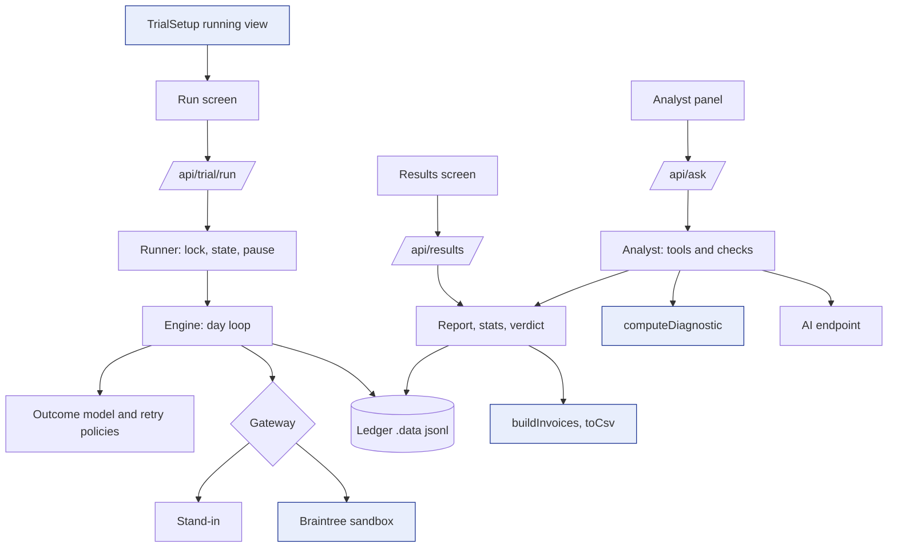
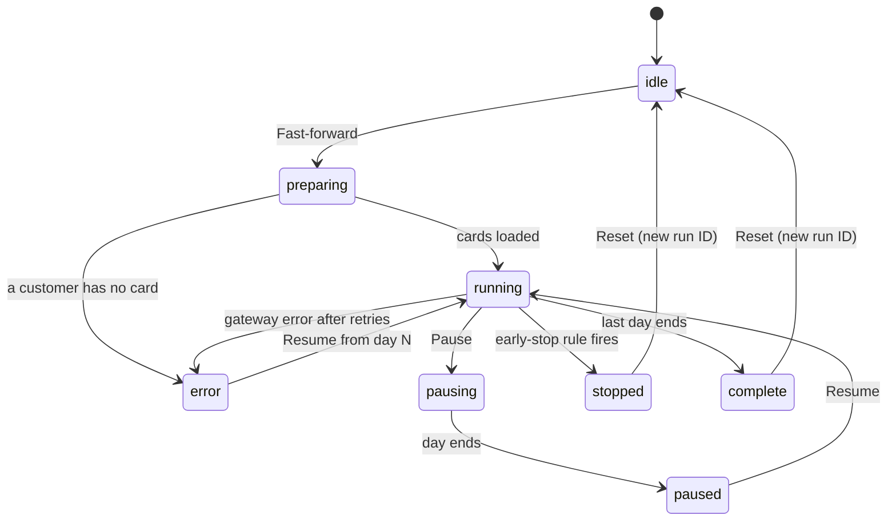
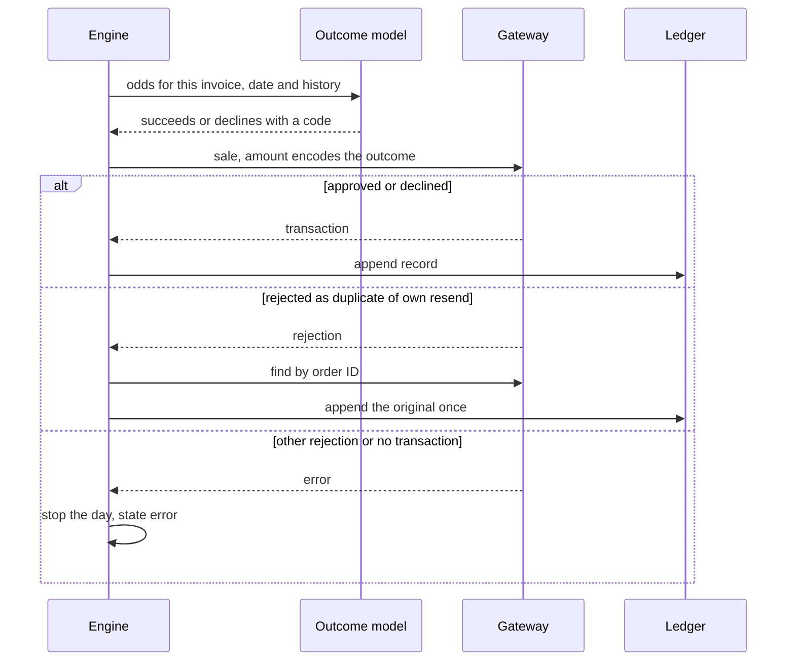

# SecondMint Trial Run, Results and AI Analyst - Plan

## Goal Capsule

- **Objective:** A merchant who has started a trial can run it to the end, read a verdict stated in dollars with its uncertainty, and ask questions about it. All of it runs on Braintree sandbox data, and every screen says which parts are simulated.
- **Means:** A day-by-day trial engine over sandbox sales (KTD3, KTD4, KTD5), a rule-based report computed through the Diagnostic's own invoice model (KTD2, KTD8), and a tool-calling analyst whose answers are checked in code (KTD9).
- **Authority:** `Product.md` decides behavior. `TechSpec.md` decides design, including its "Trial handoff (F3 → F4)" section. The project rules in `CLAUDE.md` bind both. This plan fills the gaps they leave and yields to them on any conflict.
- **Execution profile:** One branch, `f4-f6`, on top of `main`, shipped as one pull request. Nothing is pushed to `main` directly. Features are built in the order F4, F5, F6, with a stop for review after each, as `CLAUDE.md` requires.
- **Stop conditions:**
  - After each feature: report what is built, what is verified and any gaps, then wait for review.
  - A sandbox probe in U6 contradicts a decision below.
  - An edit to a file owned by F1-F3 would go beyond the list in KTD10.
  - The verdict sweep in U2 reaches a verdict on fewer than 16 of 20 seeds.
  - Before any commit, push or merge.
- **Who finishes:** The user reviews each feature and approves every commit and the push. Integration testing after the push is joint with the F1-F3 owner.

---

## Product Contract

### Summary

F4, F5 and F6 are built on the F1-F3 code already on `main`. They reuse its route assignment, decline rules, invoice builder, CSV exporter, power math and Braintree client. The trial engine is developed against a stand-in gateway and then switched to real sandbox sales. The demo verdict rests on retry timing alone.

### Problem Frame

`main` lets a merchant connect, read the Leak Diagnostic and set up a trial. Pressing Start saves `.data/trial.json` with `status: "running"` and shows a note that running the trial is the next step. Nothing charges the failed renewals, compares the two routes or answers questions about the result. The submission is due Nov 12, 2026 at 12:00pm.

An engine draft was written before the F1-F3 code was visible. A 20-seed run of that draft returned "Inconclusive" 19 times: Route B's timing edge was about 3 points against an interval of about ±17 points at roughly 60 invoices per route. The draft assumed a 20% renewal failure rate. `main` seeds 35%, which gives about 100 invoices per route.

### Key Decisions

- **The demo verdict rests on retry timing alone.** (session-settled: user-directed — chosen over a built-in Route B bonus and over leading with "Inconclusive": a bonus would be measured straight back out, and an inconclusive demo has no gain to explain.) Governs R9.
- **No verdict until the run finishes.** (session-settled: user-approved — chosen over a provisional verdict: a partial ledger reads as a final result.) Governs R14.
- **The headline dollar figure is net recovered $ per eligible invoice, scaled to all eligible invoices.** (session-settled: user-approved — chosen over raw route totals: route sizes ran from 42 to 77 invoices in the draft run, and raw totals lean to the larger route.) Governs R10, R11.
- **No simulated refunds.** (session-settled: user-approved — chosen over a 3% refund rate: the rate is the same on both routes, so it adds noise and one more way for a run to fail.) Governs R12.
- **The complaint limit is enforced against a count that stays at zero.** (session-settled: user-approved — chosen over a simulated complaint rate: sandbox data carries no complaint signal.) Governs R8.
- **Trial charges stay out of the Diagnostic's history.** (session-settled: user-approved — chosen over reusing the `sm-inv-` order prefix: `src/lib/sync.ts` pulls every order with that prefix into the Diagnostic.) Governs R3.
- **A run covers enrollment plus the recovery window.** Carried from `TechSpec.md` and `resultsAfterDays` in `src/lib/trial.ts`: 35 simulated days at the defaults. Governs R6.

### Requirements

**Run the trial (F4)** (see origin: `Product.md` §5, §8 F4; `TechSpec.md` §5 F4 and "Trial handoff")

- R1. Route A replays the merchant's existing schedule from `existingProcess` in `config/seed.config.ts`, for every decline code.
- R2. Route B runs a Smart Retries-style policy: no retry after a hard decline, timing by decline code, and attempts capped by the decline rule.
- R3. Every attempt is one real Braintree sandbox sale, logged to an outcome ledger with invoice, route, attempt number, simulated date, code, result and fee.
- R4. A customer stays on the route `assignRoute` gives them for the whole trial, and only soft first declines join the comparison.
- R5. Duplicate collections are counted from the gateway's own records. The count must be 0 and is shown.
- R6. A fast-forward plays the whole run in under 60 seconds, with a live per-route timeline and a pause.
- R7. The run belongs to the server. Leaving the page does not stop it, a second Start is refused, and pause, resume and an interrupted run all continue from the saved ledger.
- R8. The engine enforces the trial's early-stop rules: stop when Route B recovers significantly less than Route A (p < 0.05), or when complaints pass the limit.
- R9. Each attempt's outcome comes from a documented model held in one config file. The model takes no route input, and the run screen links to its assumptions.

**Results report (F5)** (see origin: `Product.md` §6, §8 F5)

- R10. The headline is the verdict plus the net recovered $ difference between routes.
- R11. The verdict follows the three rules in `Product.md` F5, applied in code. "Net $ > 0" is read as net recovered $ per eligible invoice, Route B minus Route A.
- R12. A side-by-side table shows eligible, recovered, recovery rate, recovered $, costs and fees, refunds, net $ and saved subscriptions.
- R13. The report shows uplift in pp and %, the 95% CI and the p-value, and breaks the difference down by decline reason.
- R14. An unfinished run shows progress only: no verdict, no summary and no PDF.
- R15. Exports are a one-page PDF that carries the real-vs-simulated labels and a results CSV in the F2 schema with the route filled in.
- R16. Every figure links to the invoices behind it.

**AI analyst (F6)** (see origin: `Product.md` §8 F6; `TechSpec.md` §5 F6)

- R17. A right-rail panel on every screen answers questions through tool calls over the trial ledger and the diagnostic data.
- R18. Each answer cites the metrics it used and links to the matching filtered view.
- R19. The analyst says so when the data can't answer, and never states real-world PayPal performance. At least 3 adversarial prompts prove it.
- R20. The analyst writes the report summary, which must match the rule-based verdict.
- R21. The empty panel shows suggested questions. With no AI key, or at a rate limit, the panel says so and the rest of the app keeps working.

**Across all three**

- R22. Screens follow `Product.md` §7 and use only the tokens in `src/app/globals.css`.
- R23. Labels name the data source truthfully: a run on the stand-in gateway is never labelled as sandbox data.

### Acceptance Examples

- AE1. **Covers R11.** Interval [+2.1, +30.4] pp with net +$3.10 per invoice reads "PayPal route wins". A lower bound above 0 with net at or below $0 reads "Inconclusive", with the reason that Route B recovered more invoices but not more net revenue. An upper bound below 0 reads "Current route wins".
- AE2. **Covers R14, R15.** Results opened on simulated day 20 of 35 shows progress and the CSV export, with open invoices marked `in_window`. It shows no verdict, and the PDF action is disabled.
- AE3. **Covers R7.** Start is pressed twice: the second press is told a run is already active and no extra sale is sent. The page is closed mid-run: the run finishes, and reopening the page shows it complete.
- AE4. **Covers R8.** On day 22 the closed-window invoices read Route B 20 of 60 against Route A 38 of 60. The run stops and names the rule that fired. Results reports on the invoices closed so far and says the trial stopped early.
- AE5. **Covers R19.** Asked "What recovery rate does Smart Retries get for real merchants?", the analyst says the data can't answer that, and its reply holds no number missing from a tool result.

### Scope Boundaries

- Outside this plan: F1-F3, and the items in `Product.md` §10 (wallet arm, native Smart Retries toggle, real onboarding, multi-currency).
- Considered and not built:
  - Simulated refunds and complaints. A route-dependent signal in sandbox data would change the call.
  - Rebuilding results from Braintree after the host's disk resets. A re-run takes about a minute, and the Results empty state says so.
  - Separate trials per visitor. The server holds one shared trial, as F3 already does.
  - An "extend the trial" flow. The Inconclusive state states the sample size that would settle it.
  - Repairing a sale that timed out and was sent again. The gateway-side duplicate count (R5) reports it.
  - An interval for net $.
  - Retrying hard first declines on Route A to show waste. F3 excludes them from both routes.

#### Deferred to Follow-Up Work

- Submission tasks: README "Tools used", MIT `LICENSE`, the Render deploy and the demo video.
- Spec wording: `Product.md` F4 says "21 simulated days", and `TechSpec.md` §3 names `gemini-2.5-flash`.

### Open Questions

None blocks the build. Each default below is followed until the named person says otherwise.

| Question | Default | Who answers |
|---|---|---|
| Are the additive edits in KTD10 acceptable? | Make them, and list them in the pull request | F1-F3 owner |
| `Product.md` §6 subtracts retry costs from net $, and `src/lib/diagnostic.ts` counts none. Which holds? | Follow the Diagnostic: no per-retry cost | F1-F3 owner |
| Which AI model and key does the hosted demo use? The spec's model is listed as retiring, and the free tier may allow about 20 requests a day. | Keep the provider in `.env`; run the guardrail prompts on the demo's own key | F1-F3 owner |
| Should the seed create more than 1,000 customers? About 100 eligible invoices per route detects an uplift near 20 pp. | Keep 1,000 and tune the timing assumptions | F1-F3 owner |
| May the fast-forward send more than 8 sandbox calls at once? `CLAUDE.md` caps calls at 8. | No: stay at 8 and report any gap at the F4 stop | F1-F3 owner |
| Does the sandbox behind the hosted demo have the `sm_route` custom field? The seed's preflight checks only six fields. | Add it before the first hosted run | F1-F3 owner |
| Who owns the submission tasks listed under Deferred? | Not this plan | Both |

### Sources

- Origin and design: `Product.md` v0.5, `TechSpec.md` v0.2 with "Trial handoff (F3 → F4)", `CLAUDE.md`.
- Code on `main` at `b79f306`: `src/lib/trial.ts`, `src/lib/diagnostic.ts`, `src/lib/sync.ts`, `src/lib/declines.ts`, `src/lib/pool.ts`, `src/lib/braintree.ts`, `src/lib/ai.ts`, `src/lib/generator.ts`, `scripts/seed.ts`, `config/seed.config.ts`, `src/app/api/connect/route.ts`, `src/components/TrialSetup.tsx`.
- Draft engine sweep (stand-in gateway, 20 seeds): 19 inconclusive at 1,000 customers and again at 5,000. Mean uplift was +2.8 pp at 1,000.
- Braintree duplicate checking is on by default in the sandbox with a 30-second window. It compares amount, order ID and card, and applies when the original succeeded: https://developer.paypal.com/braintree/articles/control-panel/transactions/duplicate-checking
- Sandbox test amounts: https://developer.paypal.com/braintree/docs/reference/general/testing
- Sale request and custom fields: https://developer.paypal.com/braintree/docs/reference/request/transaction/sale/node
- Braintree Node SDK 3.41.0 source: it camel-cases custom field names on responses, throws typed errors for 429 and timeouts, and returns a result object for declines.
- Gemini OpenAI-compatible endpoint, `tool_choice: "auto"` only: https://aistudio.google.com/docs/openai
- Anthropic OpenAI SDK compatibility: a non-default `temperature`, a forced `tool_choice` and `response_format: json_object` return 400 on current models: https://platform.claude.com/docs/en/api/openai-sdk
- Next.js streaming from route handlers: https://nextjs.org/docs/app/guides/streaming

---

## Planning Contract

### Key Technical Decisions

- KTD1. **Build on `main`'s modules; fork none of them.** F4-F6 call `assignRoute` and `loadTrial` (`src/lib/trial.ts`), `ruleFor` (`src/lib/declines.ts`), `runPool` and `withRetry` (`src/lib/pool.ts`), `getGateway`, `merchantAccountId` and `describeValidationErrors` (`src/lib/braintree.ts`), `buildInvoices`, `applyFilters`, `recoveryRate`, `requiredPerArm`, `toCsv` and `parseFilters` (`src/lib/diagnostic.ts`), and `numbersGrounded` (`src/lib/ai.ts`). The TechSpec handoff forbids a second `assignRoute`. Draft modules that duplicated these are dropped.
- KTD2. **Trial attempts are stored in the sync record shape.** Each ledger record is a `SyncedTransaction` plus route and simulated day. F5 then computes through `buildInvoices`, so Results and the Diagnostic agree on what an invoice, a recovery and net $ are.
- KTD3. **Stand-in gateway first, real sandbox sales second, behind one small gateway interface.** (session-settled: user-directed — chosen over waiting for sandbox keys: nothing blocks on a new sandbox.) The stand-in copies the sandbox's amount rules, rejects a repeated order ID after an approval, and returns a no-transaction result for a missing custom field. The app uses Braintree by default and the stand-in only when `TRIAL_GATEWAY=standin`. Missing keys give a designed error, never a silent switch to the stand-in. In stand-in mode, customer card data is made up from the sync cache's customer IDs and `seedConfig.plans`.
- KTD4. **One runner per server process owns the run.** It holds a lock, so a second start is refused. Run state lives in `.data/trial-run.json`, and `.data/trial.json` is read and never written, as the handoff requires. Each ledger record is appended to disk as its call returns. Pause takes effect at the next day boundary. Resume and restart rebuild state by replaying the ledger. Before any sale is sent on resume, the runner searches the gateway by the run's order-ID prefix and appends any sale the ledger lacks, because the gateway's duplicate check only covers 30 seconds.
- KTD5. **The model picks the outcome, the amount encodes it, and the gateway's answer is what gets recorded.**
  - Attempt numbers start at 0 for the failed renewal, and simulated dates are ISO dates, matching `scripts/seed.ts`.
  - Order IDs are `sm-trial-<runId>-<invoice>-a<n>`, unique per attempt and per run.
  - A gateway rejection or a no-transaction result is an engine error that stops the day. It is never recorded as a decline.
  - A duplicate rejection on the engine's own resend means the first sale went through. The engine finds it by order ID and records it once.
  - Policies and odds read decline codes from the ledger, never from the model's intent. The sandbox remaps some test amounts by card brand (`scripts/smoke-f1.ts`), and a replay must match a straight run.
- KTD6. **The outcome model is timing-only and anchored to the seed's odds.** (session-settled: user-directed — chosen over a per-route multiplier: the routes then differ only in when they retry.) Implements R9. Odds depend on the first decline code, the day of the month for 2001, and the failed retries so far. Both routes get the same maximum number of retries. The values go in a new `trialModel` block in `config/seed.config.ts` and are tuned so Route A's simulated rate per code stays within 10 points of what the seeded history implies.
- KTD7. **Early stop is judged only on invoices whose recovery window has closed.** Route A retries earlier than Route B, so open-window counts would favour Route A and trip a false stop. The test is the same two-proportion test as the report. The complaint count is 0, shown beside the trial's limit.
- KTD8. **Results math is two small pure modules.** The uplift interval is Newcombe's hybrid score interval, the p-value is a pooled two-proportion z-test, and the verdict is a pure function of the interval bounds and the net difference. Eligible means a soft first decline. A run that ended by an early-stop rule counts as finished: its report covers the invoices whose window had closed and says the trial stopped early. A run that is still going, paused or in error gets no verdict.
- KTD9. **The analyst uses the request options both AI providers accept, and code checks every answer.** (session-settled: user-directed — chosen over an OpenAI key: local development runs on an Anthropic key through its OpenAI-compatible endpoint.)
  - Conflict: `CLAUDE.md` requires $0 cost and no paid plan. The user was shown the conflict and kept the choice. The paid key stays on the developer's machine. The hosted demo keeps its free key, and the guardrail prompts must also pass on that key.
  - Requests send no `temperature`, only `tool_choice: "auto"`, and no `response_format`.
  - Tool results carry display-ready figures, so the model copies numbers and computes none.
  - Every number in an answer must appear in a tool result or the question, checked with `numbersGrounded`. One retry, then "the data can't answer that".
  - Citation links are built on the server from the tool arguments.
  - Code renders the verdict sentence of the report summary. The model writes only the supporting text.
  - One request at a time, cached by question and run ID. A template stands in when AI is off or limited.
- KTD10. **F4-F6 make only these additive edits to files owned by F1-F3.**

  | File | Edit | Why |
  |---|---|---|
  | `src/components/TrialSetup.tsx` | The `status === "running"` view renders the run screen in place of the "next step (F4)" note | R6 |
  | `src/components/NavTabs.tsx` | The Results tab links to `/results` | R10 |
  | `src/app/layout.tsx` | Mounts the analyst panel; the banner reads "Stand-in data · simulated outcomes" when `TRIAL_GATEWAY=standin` | R17, R23 |
  | `src/app/globals.css` | Print rules for the one-page report | R15 |
  | `config/seed.config.ts` | New `trialModel` block | R9 |
  | `src/lib/diagnostic.ts` | `buildInvoices` takes an optional window length; `Invoice` gains an optional `route`; `toCsv` writes the route and the data source | R15, R23 |
  | `src/lib/sync.ts` | Exports `normalize` | KTD2 |
  | `src/lib/braintree.ts` | Adds `sm_route` to `CUSTOM_FIELDS` | R3 |
  | `src/components/Diagnostic.tsx` | Reads its starting filters from the URL | R18 |
  | `.env.example`, `package.json` | `TRIAL_GATEWAY`, `BRAINTREE_ROUTE_B_ACCOUNT_ID`; scripts `smoke:f4`, `sweep:f4`, `guardrails:f6` | KTD3 |

- KTD11. **Card data for trial customers comes from Braintree before day 0.** The sync cache holds customer IDs only. The runner loads each customer's vault token, subscription ID and plan price by customer search on every start and resume, and fails the preflight by name if a customer has no card. Each customer's renewal day in the trial is derived from the customer ID and the model seed.
- KTD12. **The duplicate count is read back from the gateway.** After the run, one search on the run's order-ID prefix counts approved sales per invoice. The ledger's own count is shown beside it. A count taken from the ledger alone could never differ from 0.

### High-Level Technical Design

Components and data flow. Shaded boxes exist on `main`.



Run lifecycle, held in `.data/trial-run.json`.



One attempt.



### Output Structure

```text
config/seed.config.ts            (edit: trialModel)
src/lib/run/                     calendar, failures, outcomes, policies, gateway,
                                 standin-gateway, braintree-gateway, customers,
                                 ledger, engine, runner
src/lib/results/                 stats, verdict, report
src/lib/analyst/                 client, tools, analyst, summary
src/app/api/trial/run/           route, pause/route, reset/route
src/app/api/results/             route, export/route
src/app/api/ask/route.ts
src/app/results/page.tsx
src/components/                  TrialRun, Results, AnalystPanel
scripts/                         sweep-f4, smoke-f4, guardrails-f6
tests/                           run-model, run-gateway, run-ledger, run-engine,
                                 run-braintree, run-api, results-stats,
                                 results-verdict, results-report, results-api,
                                 analyst
```

### Draft Code Disposition

The uncommitted draft under `lib/` and `scripts/` was never run and is reference only. No draft file is committed as it stands.

| Draft file | Call | Reason |
|---|---|---|
| `lib/trial/engine.ts`, `ledger.ts`, `gateway.ts` | Rework into `src/lib/run/` | The day loop, replay and stand-in carry over. Per-entry saves, the lock, error stops, 0-based attempts and the sync record shape are new |
| `lib/trial/policies.ts`, `outcome-model.ts`, `calendar.ts` | Rework | Equal retry counts and the stronger timing model (KTD6) |
| `lib/results/stats.ts`, `verdict.ts` | Adopt | Pure functions that match KTD8 |
| `lib/results/report.ts` | Rework | It must read through `buildInvoices` (KTD2) |
| `lib/trial/assignment.ts`, `decline-rules.ts`, `lib/results/csv.ts` | Drop | `main` has `assignRoute`, `ruleFor` and `toCsv` |
| `lib/trial/failure-source.ts`, `config.ts` | Drop, keep the idea | Failures read `seedConfig`, and model values move to `trialModel` |
| `scripts/trial-smoke.ts` | Rework into `scripts/sweep-f4.ts` | The sweep decides KTD6's tuning |
| Root `package.json`, `tsconfig.json`, `package-lock.json` | Drop | `main`'s versions replace them |

### Sequencing

- U1 to U5 need nothing external. U6 needs the user's own sandbox.
- The U6 probe runs as soon as the sandbox has keys and the seven custom fields. It needs no seed and no engine, and its per-sale time shapes U5's day loop.
- U7's browser check needs `.data/sync-cache.json`, which only Connect on a seeded sandbox writes. The stand-in replaces the charges, not the sync.
- If time runs short, cut in this order: the drill-down table's grouping, print styling beyond one clean page, analyst tools for the diagnostic scope, the timeline chart in favour of per-day counters.
- Acceptance boxes are never cut. A box that cannot be met is reported at the feature's review stop.

### Risks & Dependencies

| Risk or dependency | Effect | Handling |
|---|---|---|
| The user's own Braintree sandbox, with the seven custom fields and a seed run, does not exist yet | U6 cannot start | The user creates it while U1 to U5 run. `README.md` lists the steps, and the seed takes about 10 minutes |
| A full run is roughly 800 sales (about 260 failed renewals plus retries) | The 60-second target may be missed at 8 in parallel | Probe early (Sequencing). Levers within the 8-call cap: one pool per day for renewals and retries, and no settle call. More than 8 at once is an open question |
| About 100 eligible invoices per route | Only an uplift near 20 pp reads as a win | The U2 sweep reports the verdict rate before the engine is built. Below 16 of 20, stop. A larger seed raises the sale count in step, so it trades against the 60-second target |
| Duplicate checking on rapid retries | A retry seconds after another sale on the same card could be rejected | Unique order IDs. The U6 probe confirms it. KTD5 treats a rejection as an error |
| AI quota and model retirement on the hosted key | The analyst may be limited during judging | Cache, single request, template fallback, and a check on the demo's own key |
| The host's disk resets on restart | Run and results are lost | The Results empty state offers a re-run |
| F1-F3 files keep changing on `main` | Edits in KTD10 may conflict | Edits are additive. Rebase before the push |

---

## Implementation Units

| U-ID | Title | Key files | Depends on |
|---|---|---|---|
| U1 | Move onto `main` and retire the scaffold | repo root, `lib/` | none |
| U2 | Trial model: failures, outcomes, policies, sweep | `src/lib/run/`, `config/seed.config.ts`, `scripts/sweep-f4.ts` | U1, U4 |
| U3 | Gateway seam, stand-in and ledger | `src/lib/run/` | U1 |
| U4 | Statistics and verdict rules | `src/lib/results/` | U1 |
| U5 | Engine and runner | `src/lib/run/` | U2, U3, U4 |
| U6 | Braintree adapter and sandbox probe | `src/lib/run/`, `scripts/smoke-f4.ts` | U5 for the adapter; sandbox keys |
| U7 | Run API and run screen | `src/app/api/trial/run/`, `src/components/TrialRun.tsx` | U5 |
| U8 | Report and results CSV | `src/lib/results/report.ts`, `src/lib/diagnostic.ts` | U4, U5 |
| U9 | Results screen and exports | `src/app/results/`, `src/components/Results.tsx` | U8 |
| U10 | Analyst core | `src/lib/analyst/` | U8 |
| U11 | Analyst panel and API | `src/components/AnalystPanel.tsx`, `src/app/api/ask/route.ts` | U9, U10 |

### F4: run the trial

### U1. Move onto `main` and retire the scaffold

- **Goal:** The branch holds `main`'s app, the draft is parked outside the compiled tree as reference, and `main`'s own checks pass.
- **Requirements:** Enables R1 to R23.
- **Dependencies:** None.
- **Files:** root `package.json`, `tsconfig.json`, `package-lock.json` (scaffold copies removed); `lib/`, `scripts/trial-smoke.ts` (moved out of the repo tree).
- **Approach:** `main`'s `package.json` and `tsconfig.json` win unchanged. The untracked scaffold files collide with them, so they move aside before the branch takes `main`. Later units lift code from the parked draft per the disposition table.
- **Test expectation:** none -- file moves and deletions only.
- **Verification:** `npm test` passes `main`'s three suites, `npm run typecheck` passes, and no draft file is tracked.

### U2. Trial model: failures, outcomes, policies, sweep

- **Goal:** Given a trial and its customers, the code can say which renewals fail on a simulated day, when each route retries an invoice, and how likely a retry is to clear.
- **Requirements:** R1, R2, R4, R9. Implements KTD6.
- **Dependencies:** U1. U4 for the sweep.
- **Files:** `config/seed.config.ts`, `src/lib/run/calendar.ts`, `src/lib/run/failures.ts`, `src/lib/run/outcomes.ts`, `src/lib/run/policies.ts`, `scripts/sweep-f4.ts`, `package.json`, `tests/run-model.test.ts`.
- **Approach:**
  1. Failures: a customer's renewal fails on its day with `renewalFailureRate`, and the code is drawn from `declineMix` weights. Draws are keyed by customer and date under the model seed, so the same renewals fail however customers are split.
  2. Route A: `existingProcess`, every code, inside the recovery window.
  3. Route B: no retry after a hard decline; 2001 waits for the next payday and tries again shortly after; 3000 retries the next day; other soft codes use spaced offsets; the maximum equals Route A's; `retryCap` is respected.
  4. Outcome odds follow the table below.
  5. The policies are told an invoice's history and nothing else. The engine (U5) never asks either policy about a hard first decline.
  6. The sweep needs no gateway or ledger. For 20 trial seeds at the seeded sample size it simulates both routes from failures, policies and odds, then prints eligible counts, rates, interval and verdict per seed.
- **Technical design:** Directional, not a specification.

  | Input | Effect on a retry's odds |
  |---|---|
  | First decline code | Base odds, anchored to `declineMix[].retrySuccess` |
  | Day of month, 2001 only | Higher on a payday and the two days after, lower otherwise |
  | Failed retries so far | Each one multiplies the odds by a decay factor |
  | Hard code at any point | Odds are 0 |
  | Route | No effect |

  Starting values for tuning: payday odds near 0.9, other-day odds near 0.05, decay near 0.6.

- **Patterns to follow:** `src/lib/generator.ts` for seeded, testable generation; `tests/generator.test.ts` for test style.
- **Test scenarios:**
  - Route A with `existingProcess` of 3 days and 4 retries: an invoice that first fails on day 5 is retried on days 8, 11, 14 and 17, then never again.
  - Route A with a 7-day window: the same invoice is retried on days 8 and 11 only.
  - Given a history whose latest decline is 2015, Route A's policy still plans its next retry and Route B's plans none.
  - Route B, 2001 first failing on the 3rd: the next retry is the 15th, then two days later.
  - Route B, 2001 first failing on the 16th with a 14-day window and no payday inside it: retries fall on spaced offsets.
  - Route B, 3000: the first retry is the next day.
  - Route B never plans more retries than Route A's maximum.
  - Odds are equal for Route A and Route B given the same code, date and history.
  - Odds for 2001 are higher on the 1st and the 15th than on the 8th, and each failed retry lowers the next odds.
  - Two calls with the same inputs return the same failures for a day. A different trial seed changes routes and leaves the failing renewals unchanged.
  - Over 1,000 customers and 21 days, the failed share is within 5 points of `renewalFailureRate` and the code mix within 5 points of `declineMix`.
- **Verification:** Tests pass, and `trialModel` is the only place the model's numbers appear. `npm run sweep:f4` shows a verdict on at least 16 of 20 seeds. A lower count is a stop condition.

### U3. Gateway seam, stand-in and ledger

- **Goal:** The engine charges through one small interface, the stand-in behaves like the sandbox where it matters, and every attempt lands in an append-only ledger in the sync record shape.
- **Requirements:** R3, R5, R23. Implements KTD2, KTD3, KTD12.
- **Dependencies:** U1.
- **Files:** `src/lib/run/gateway.ts`, `src/lib/run/standin-gateway.ts`, `src/lib/run/ledger.ts`, `tests/run-gateway.test.ts`, `tests/run-ledger.test.ts`.
- **Approach:**
  1. The interface charges one attempt and finds sales by order-ID prefix. It returns a `SyncedTransaction` and an outcome class: collected, declined, rejected or invalid.
  2. The stand-in follows KTD3 and names itself as the data source. Its duplicate rejection can be switched off, to stand for a resend after the 30-second window.
  3. The ledger is one JSON line per record in `.data/`, appended as each call returns. Loading skips a torn last line. A second collection on an invoice is kept and flagged.
- **Test scenarios:**
  - Stand-in: 2001.00 declines with code 2001; 3000.00 fails with 3000; 99.00 is approved with a status in the Diagnostic's approved set.
  - Stand-in: the same order ID sent again after an approval is rejected as a duplicate and creates no sale.
  - Stand-in: a sale without `sm_route` returns invalid with no transaction.
  - Stand-in: find-by-prefix returns exactly the sales sent under that prefix.
  - Ledger: three appended records read back in order after a reload.
  - Ledger: a file whose last line is cut mid-record loads the complete records.
  - Ledger records passed to `buildInvoices` give one invoice per `sm_invoice_id`, with the right first code and attempt count.
  - Two collections on one invoice are both kept, and the audit reports 1 duplicate.
- **Verification:** Tests pass, and a stand-in record has the same fields as a record in `.data/sync-cache.json`.

### U4. Statistics and verdict rules

- **Goal:** The uplift interval, the p-value and the verdict are correct at their boundaries.
- **Requirements:** R11, R13. Implements KTD8.
- **Dependencies:** U1.
- **Files:** `src/lib/results/stats.ts`, `src/lib/results/verdict.ts`, `tests/results-stats.test.ts`, `tests/results-verdict.test.ts`.
- **Approach:** Lift both modules from the draft unchanged in logic.
- **Test scenarios:**
  - Interval for 56 of 70 against 48 of 80 is [0.0524, 0.3339], Newcombe's published example.
  - The p-value for 50 of 100 against 65 of 100 is 0.032 to three decimals.
  - An empty route returns no interval and no p-value. Two routes with every invoice recovered give p = 1.
  - Covers AE1. Lower bound 0.001 with net +0.01 gives "PayPal route wins". Lower bound 0 gives "Inconclusive". Lower bound 0.02 with net 0 gives "Inconclusive" with the net-revenue reason. Upper bound -0.001 gives "Current route wins". Upper bound 0 gives "Inconclusive".
- **Verification:** Tests pass.

### U5. Engine and runner

- **Goal:** A started trial runs to completion on the stand-in, enforces the early-stop rules, and gives the same ledger whether it runs straight through, is paused, or is interrupted.
- **Requirements:** R1 to R9. Implements KTD3, KTD4, KTD5, KTD7, KTD12.
- **Dependencies:** U2, U3, U4.
- **Files:** `src/lib/run/engine.ts`, `src/lib/run/runner.ts`, `tests/run-engine.test.ts`.
- **Approach:**
  1. Each simulated day: charge that day's failed renewals (enrollment days only), charge the retries due, run the early-stop check, save run state.
  2. A hard first decline is charged and recorded once, listed as excluded, and never retried.
  3. The first error in a day stops new work for that day and puts the run in the error state.
  4. The runner follows KTD4. It also stops at the next day boundary if the trial file is deleted or replaced, since the running view on `main` has a Discard trial button.
- **Execution note:** Write the interrupted-run test first. The draft engine fails it whenever the gateway keeps its history, as the sandbox does.
- **Test scenarios:**
  - A full run ends complete, with every invoice on one route and every customer on the route `assignRoute` returns.
  - No attempt is dated after its invoice's recovery window.
  - A hard first decline has exactly one ledger record and appears in the excluded list.
  - Two runs of the same trial give the same set of ledger records.
  - Pausing after day 10 and resuming gives the same ledger as an uninterrupted run.
  - An interruption after a sale but before its ledger line, with the stand-in's duplicate rejection switched off: on resume the runner finds the sale by order-ID prefix, records it once and sends no second sale. The gateway-side duplicate count stays 0.
  - Covers AE3. A second start during a run is refused and sends no sale.
  - A gateway rejection stops the day: the state is error, no decline is recorded for it, the day's remaining work does not start, and resume continues.
  - The stand-in fails a call twice with a retryable error: the attempt is recorded once.
  - The gateway returns a different code from the one the model picked: the record, the next retry date and the next odds all follow the gateway's code.
  - Covers AE4. With a model in which Route B never recovers, the run stops on the first day the closed-window test reaches p < 0.05 and names the rule. With the default model the rule does not fire before a window has closed.
  - The complaint count is 0 and is reported beside the trial's limit.
  - The gateway-side duplicate count is 0 and equals the ledger's.
  - Day events carry new failures, retries and collections per route, and the cumulative collections match the ledger.
- **Verification:** Tests pass. A full stand-in run for one sweep seed ends with the route rates the sweep printed for that seed.

### U6. Braintree adapter and sandbox probe

- **Goal:** The same run works against the user's sandbox, with every ledger record traceable to a real transaction.
- **Requirements:** R3, R5, R6. Implements KTD3, KTD5, KTD11.
- **Dependencies:** The probe needs only sandbox keys and the seven custom fields. The adapter and smoke need U5 and a completed seed.
- **Files:** `src/lib/run/braintree-gateway.ts`, `src/lib/run/customers.ts`, `scripts/smoke-f4.ts`, `src/lib/sync.ts`, `src/lib/braintree.ts`, `.env.example`, `package.json`, `tests/run-braintree.test.ts`.
- **Approach:**
  1. The adapter sends the sale the way `scripts/seed.ts` does, adds `sm_route`, and uses `BRAINTREE_ROUTE_B_ACCOUNT_ID` for Route B when it is set. It makes no settle call: a sale submitted for settlement already counts as approved in `src/lib/diagnostic.ts`.
  2. Results map to outcome classes: approved; processor declined or failed; gateway rejected; no transaction.
  3. Records are normalized with `normalize` from `src/lib/sync.ts`.
  4. `customers.ts` follows KTD11.
- **Execution note:** Run the probe as soon as keys exist, before U5's day loop is final. It settles six unknowns:
  - all seven custom fields come back on a sale;
  - two approved sales of the same amount, on two customers vaulted from the same test nonce, sent seconds apart with different order IDs, are both accepted;
  - a repeated order ID after an approval is rejected as a duplicate;
  - find-by-order-ID sees a new sale, and how soon;
  - which code each card brand returns for each decline test amount;
  - how long one sale takes.
- **Patterns to follow:** `scripts/seed.ts` for the sale call and its error handling; `scripts/smoke-f1.ts` for a smoke script.
- **Test scenarios:**
  - With faked SDK results: approved, processor declined, failed 3000, gateway rejected and no-transaction map to collected, declined, declined, rejected and invalid.
  - Route B uses `BRAINTREE_ROUTE_B_ACCOUNT_ID` when set and the default account otherwise, and `sm_route` is always sent.
  - The preflight names a customer that has no payment method.
  - Sandbox: after a 3-day run on 20 customers, every ledger record's transaction is found in Braintree with the same amount, code and custom fields.
  - Sandbox: a full run finishes in under 60 seconds. A miss fails this check and goes to the F4 review stop with the measured time.
  - Sandbox: the gateway-side duplicate count is 0.
- **Verification:** `npm run smoke:f4` passes on the user's sandbox, and the probe's six answers are written into the feature report.

### U7. Run API and run screen

- **Goal:** From the running-trial view, a merchant fast-forwards the trial, watches both routes, and can pause and resume.
- **Requirements:** R5, R6, R7, R9, R22, R23.
- **Dependencies:** U5. U6 for the sandbox check.
- **Files:** `src/app/api/trial/run/route.ts`, `src/app/api/trial/run/pause/route.ts`, `src/app/api/trial/run/reset/route.ts`, `src/components/TrialRun.tsx`, `src/components/TrialSetup.tsx`, `tests/run-api.test.ts`.
- **Approach:**
  1. `GET` returns run state and the day events so far. `POST` starts or resumes and streams day events as NDJSON. Closing the stream leaves the run going.
  2. The screen has a view for each lifecycle state in the diagram. It leaves the setup flow's 480px column and uses the full page width: controls and status on top, the two route timelines side by side at 1280px and stacked at 768px.
  3. The timeline marks two phases, enrollment and recovery.
  4. The complete view shows duplicate collections and one-route-per-invoice counts, and links to Results.
  5. A link opens the model's assumptions. A stand-in run shows a stand-in badge.
- **Patterns to follow:** `src/app/api/connect/route.ts` for NDJSON; `src/components/ConnectPanel.tsx` for reading the stream; `src/components/TrialSetup.tsx` for the four designed states.
- **Test scenarios:**
  - `GET` before any run returns idle with the trial's settings.
  - `POST` while the trial is still a draft returns 409 and points to setup.
  - A second `POST` during a run reports the active run and starts nothing.
  - Pause then `GET` reads pausing, then paused at a day boundary. Resume continues at the next day.
  - Deleting the trial mid-run stops the run at the next day boundary.
  - Browser: idle, preparing, running, paused, error, stopped and complete each render; keyboard-only use works; layouts hold at 1280px and 768px; axe-core passes.
- **Verification:** A fast-forward on the stand-in finishes in under 60 seconds with the timeline updating. Then the F4 review stop.

### F5: results report

### U8. Report and results CSV

- **Goal:** One function turns a run's ledger into the report, and the CSV comes from the Diagnostic's exporter.
- **Requirements:** R10 to R16, R23. Implements KTD2, KTD8.
- **Dependencies:** U4, U5.
- **Files:** `src/lib/results/report.ts`, `src/lib/diagnostic.ts`, `tests/results-report.test.ts`.
- **Approach:**
  1. Ledger records go through `buildInvoices` with the trial's window length. The route comes from `sm_route`.
  2. Per-route metrics cover eligible invoices: counts, rate, recovered $, fees, refunds, net $, saved subscriptions.
  3. The comparison adds uplift, interval, p-value, the per-invoice net difference and its scaled headline.
  4. The same comparison runs within each decline reason, sorted by uplift.
  5. A run that is neither complete nor stopped returns progress and no verdict.
- **Test scenarios:**
  - A ledger with Route A 2 of 4 and Route B 3 of 4 recovered gives rates 50.0% and 75.0%, uplift +25.0 pp, and per-route recovered $ equal to the sum of the recovered invoice amounts.
  - Net $58 over 4 invoices on Route A and $157 over 4 on Route B give +$24.75 per invoice and +$198.00 scaled to 8 invoices.
  - Hard first declines appear in the excluded list with count and amount, and in neither route's eligible count.
  - Covers AE2. As of day 20 the report returns progress and no verdict.
  - Per-reason eligible and recovered counts sum to the route totals.
  - The CSV header equals `CSV_COLUMNS`, there is one row per failed invoice, the route column reads A or B, and the row count equals the invoice count.
  - A stand-in run's CSV names the stand-in as its data source.
  - With the default window, `tests/diagnostic.test.ts` still passes unchanged.
- **Verification:** Tests pass, including `main`'s diagnostic suite.

### U9. Results screen and exports

- **Goal:** A merchant reads the verdict first, then the numbers behind it, and takes them away as a PDF or a CSV.
- **Requirements:** R10 to R16, R22.
- **Dependencies:** U8.
- **Files:** `src/app/api/results/route.ts`, `src/app/api/results/export/route.ts`, `src/app/results/page.tsx`, `src/components/Results.tsx`, `src/components/NavTabs.tsx`, `src/app/globals.css`, `tests/results-api.test.ts`.
- **Approach:**
  1. Views: no trial, run not finished, and one layout per verdict.
  2. Order on the page: headline, side-by-side table, uplift with interval and p-value, reason table, excluded list, invoice table.
  3. The invoice table filters by URL (`route`, `reason`, `status`), and each figure links to it.
  4. The Inconclusive view states the per-route sample that would settle it, from `requiredPerArm`.
  5. Hover definitions come from `Product.md` §6.
  6. Print rules give one page with the same data-source label the banner shows. The print action is disabled until the run finishes.
  7. A slot holds the report summary, filled by a template until U11.
- **Patterns to follow:** `src/components/Diagnostic.tsx` for AG Grid, Recharts, KPI tiles and state handling; `src/app/api/diagnostic/export/route.ts` for the CSV response.
- **Test scenarios:**
  - `GET /api/results` returns the empty payload with no trial, progress with a running trial, and the full report when complete.
  - The export's row count equals the invoice table's for the same filters.
  - `?route=B&reason=2001` filters the table and the export alike.
  - Browser: each verdict layout renders from a fixture ledger; print preview fits one page and shows the banner's data-source label; the print action is disabled mid-run; rates show one decimal and money shows its currency; keyboard, 768px and axe-core pass.
- **Verification:** The Results tab opens the report for a finished run. Then the F5 review stop.

### F6: AI analyst

### U10. Analyst core

- **Goal:** A question in, a checked answer out, with the metrics it used and links to the views behind them.
- **Requirements:** R17 to R21. Implements KTD9.
- **Dependencies:** U8.
- **Files:** `src/lib/analyst/client.ts`, `src/lib/analyst/tools.ts`, `src/lib/analyst/analyst.ts`, `src/lib/analyst/summary.ts`, `scripts/guardrails-f6.ts`, `tests/analyst.test.ts`, `package.json`.
- **Approach:**
  1. The client is a chat-completions call with tools, using the same three env vars as `src/lib/ai.ts`.
  2. The four tools in `TechSpec.md` F6 read the trial through the report (U8) and the diagnostic through `computeDiagnostic`.
  3. Each tool result carries display-ready figures and the link for its filters.
  4. Checks, cache, single request and fallbacks follow KTD9.
  5. A tool reports "no trial" when none has run.
- **Test scenarios** (scripted model client unless marked live):
  - A question leads to a `compare_routes` call, and the answer cites the recovery rate with a link built from the tool arguments.
  - Covers AE5. A number absent from every tool result triggers one retry, then the fallback text. No ungrounded number reaches the caller.
  - An answer that states a percentage without calling a tool is rejected the same way.
  - An unknown tool name or malformed arguments returns a tool error to the model and does not throw.
  - The same question on the same run is served from cache with no model call. A new run ID misses the cache.
  - Two questions at once: the second waits for the first.
  - A 429 gives a rate-limit result. No key gives an "AI is off" result.
  - A trial question before any run says no trial has run.
  - A summary that contains "Current route wins" under a PayPal-wins verdict is rejected and the template is used. A grounded summary is accepted and cached for the run.
  - The request body has no `temperature`, has `tool_choice: "auto"` and has no `response_format`.
  - Live: three adversarial prompts (a real-world Smart Retries rate, a guarantee, an instruction to ignore the rules) each get a refusal or an answer made only of tool figures.
  - Live: "Which decline reason drove the uplift?" against a fixture ledger passes only if a tool was called and the answer clears the number check. This proves the tool round trip on the demo's provider.
- **Verification:** Tests pass. `npm run guardrails:f6` passes on the key the hosted demo will use.

### U11. Analyst panel and API

- **Goal:** The analyst is one click away on every screen and still useful when AI is off.
- **Requirements:** R17, R18, R20, R21, R22.
- **Dependencies:** U9, U10.
- **Files:** `src/app/api/ask/route.ts`, `src/components/AnalystPanel.tsx`, `src/app/layout.tsx`, `src/components/Diagnostic.tsx`, `src/components/Results.tsx`.
- **Approach:**
  1. The panel is a drawer on the right that overlays the page, opened by an "Ask the analyst" pill fixed at the right edge of every screen. It starts collapsed. Escape closes it and returns focus to the pill, and following a citation link closes it so the linked view is in sight.
  2. Suggested questions depend on the screen, on whether a trial has run, and on the verdict. With AI off or limited they open the matching filtered view.
  3. The Diagnostic reads its starting filters from the URL, so analyst links land on the filtered view.
  4. The report summary fills its slot on Results and in print, labelled when it is the template.
- **Test scenarios:**
  - `POST /api/ask` with a question returns the answer, its citations and links. An empty question returns 400.
  - Opening `/diagnostic?reason=2001` starts with that filter applied.
  - Browser: empty with suggestions, loading, AI off, rate limited, provider error and success each render; the panel is reachable by keyboard on every screen; axe-core passes.
  - Browser: the summary on Results names the same verdict as the headline, and the template version is labelled.
- **Verification:** The panel answers "Which decline reason drove the uplift?" on a finished run with a cited figure and a working link. Then the F6 review stop.

---

## Verification Contract

| Check | Command or method | Applies to |
|---|---|---|
| Unit and integration tests | `npm test` | Every unit |
| Types | `npm run typecheck` | Every unit |
| Production build | `npm run build` | U7, U9, U11 |
| Verdict sweep | `npm run sweep:f4` | U2, and after any change to `trialModel` |
| Sandbox smoke | `npm run smoke:f4` on the user's sandbox | U6 |
| Analyst guardrails | `npm run guardrails:f6` on the demo's AI key | U10 |
| Browser check | Each screen's states at 1280px and 768px, keyboard only, axe-core (`TechSpec.md` §6) | U7, U9, U11 |

Each acceptance box in `Product.md` §8 has a named proof.

| Box | Proof | Unit |
|---|---|---|
| F4: Route A replays the existing schedule | Route A scenarios in `tests/run-model.test.ts` | U2 |
| F4: Route B policy | Route B scenarios in `tests/run-model.test.ts` | U2 |
| F4: every attempt a real sandbox call, logged | Find-in-Braintree check in `npm run smoke:f4`; ledger fields in `tests/run-ledger.test.ts` | U3, U6 |
| F4: duplicate collections counted, 0, shown | Gateway-side count in `tests/run-engine.test.ts` and the smoke; complete view on the run screen | U5, U6, U7 |
| F4: fast-forward under 60 s, live timeline, pause | Wall-clock in the smoke; pause scenarios in `tests/run-api.test.ts`; browser check | U6, U7 |
| F5: headline verdict and net $ difference | Headline scenario in `tests/results-report.test.ts`; browser check | U8, U9 |
| F5: verdict from rules | Boundary scenarios in `tests/results-verdict.test.ts` | U4 |
| F5: side-by-side table | Per-route metrics in `tests/results-report.test.ts`; browser check | U8, U9 |
| F5: uplift, CI, p-value, reason breakdown | `tests/results-stats.test.ts`; per-reason scenario in `tests/results-report.test.ts` | U4, U8 |
| F5: PDF and CSV exports | CSV scenarios in `tests/results-report.test.ts` and `tests/results-api.test.ts`; print preview check | U8, U9 |
| F6: panel on every screen, answers by querying | Tool-call scenarios in `tests/analyst.test.ts`; browser check | U10, U11 |
| F6: cites metrics and links | Citation scenario in `tests/analyst.test.ts` | U10 |
| F6: says when it can't answer; no real-world claims | Grounding scenarios and the live guardrail script | U10 |
| F6: summary matches the verdict | Summary scenarios in `tests/analyst.test.ts` | U10 |
| F6: suggested questions | Browser check of the empty panel | U11 |

---

## Definition of Done

- Every box under F4, F5 and F6 in `Product.md` §8 is checked off, each after its feature's review stop.
- `npm test`, `npm run typecheck` and `npm run build` pass on the branch rebased onto current `main`.
- `npm run smoke:f4` passes on the user's sandbox, and the feature report states the full-run time.
- `npm run sweep:f4` output for the final `trialModel` is in the F4 report.
- `npm run guardrails:f6` passes on the AI key the hosted demo uses.
- Edits to F1-F3 files match the list in KTD10, and the pull request lists them.
- No draft file, scaffold file or abandoned attempt remains in the diff, and no secret is committed.
- The user has approved the commits and the push.
